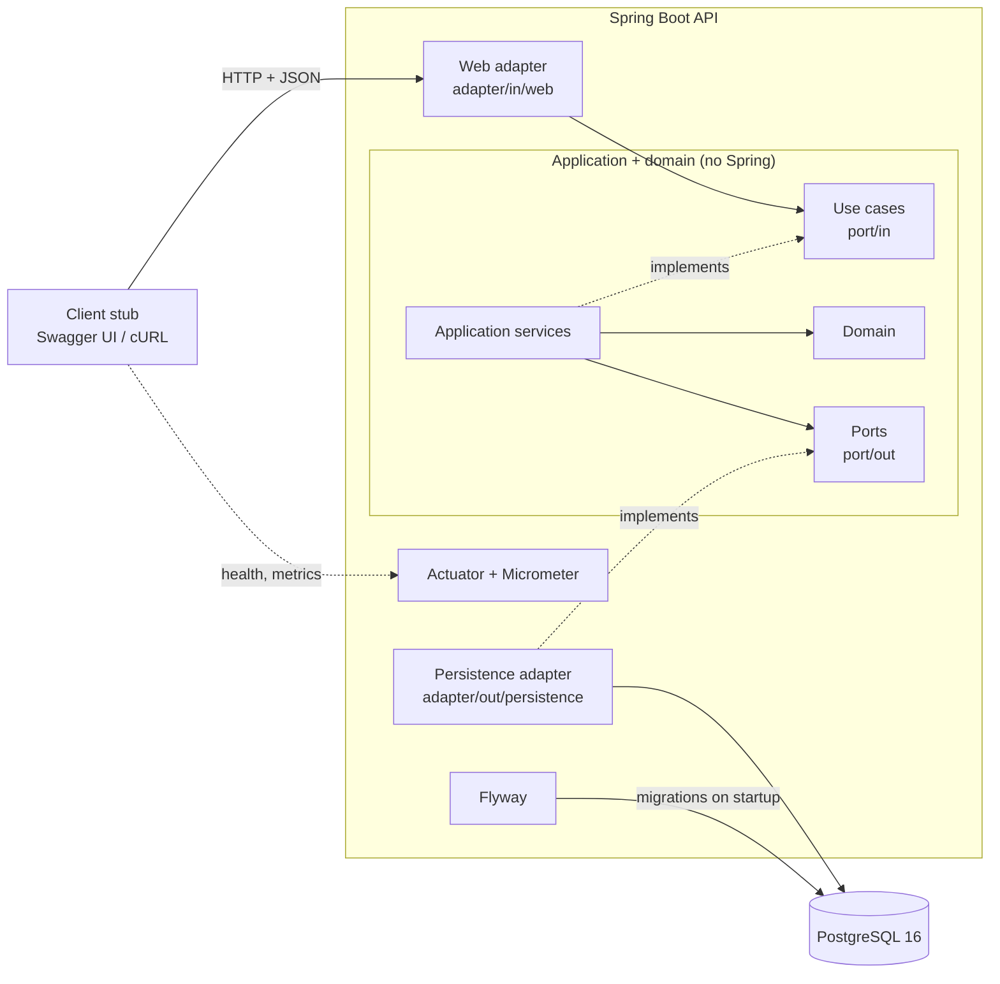
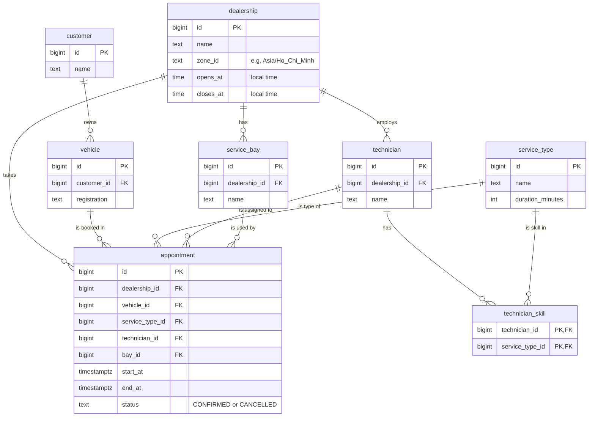
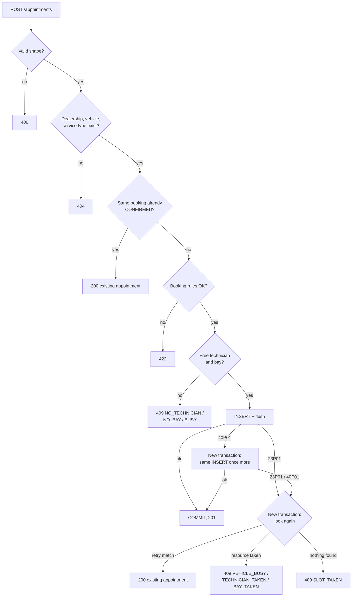
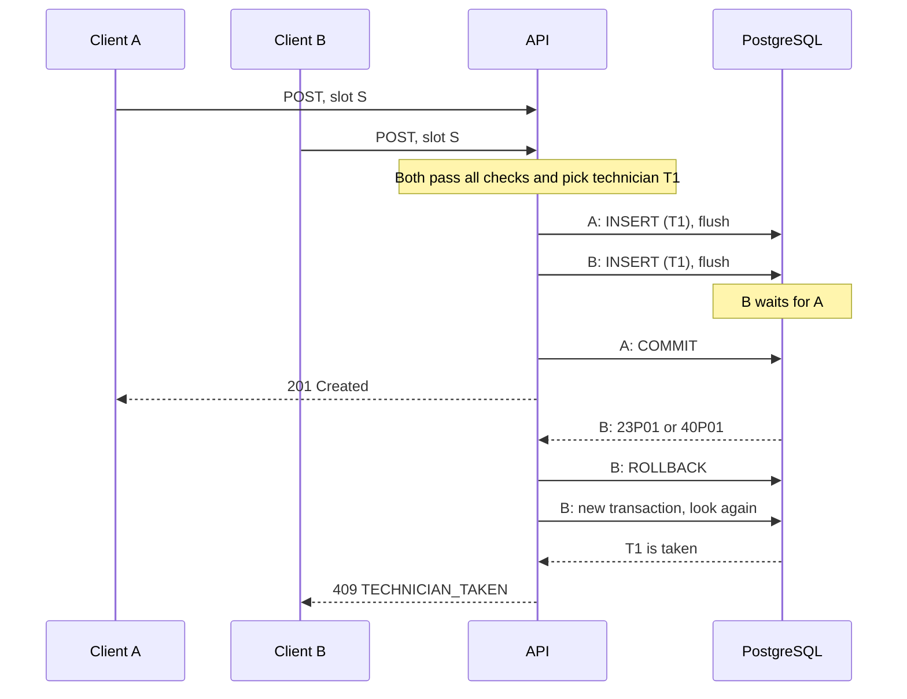

# System Design: Unified Service Scheduler

Keyloop challenge, Scenario A. Backend only. **PROPOSED:** = not decided yet.

## 1. Overview

The service books a service appointment for a vehicle at a dealership.
It picks a qualified technician and a free bay, and checks availability in the same transaction as the insert.
If two requests want the same technician, bay or vehicle, the first commit wins. The other gets 409.

## 2. Rules

### Booking checks

| Rule | If broken |
|---|---|
| Request has the right shape: required fields, formats, time with offset | 400 `INVALID_REQUEST` |
| Dealership, vehicle and service type exist | 404 `DEALERSHIP_NOT_FOUND`, `VEHICLE_NOT_FOUND`, `SERVICE_TYPE_NOT_FOUND` |
| Start time is a whole minute (no seconds) | 422 `START_NOT_WHOLE_MINUTE` |
| Start time is after now | 422 `START_IN_PAST` |
| Start date is at most 90 days ahead (dealership calendar, day 90 allowed) | 422 `START_TOO_FAR_AHEAD` |
| The whole service fits inside opening hours | 422 `OUTSIDE_OPENING_HOURS` |
| At least one technician at the dealership has the skill | 422 `SERVICE_NOT_OFFERED` |
| A qualified technician is free | 409 `NO_TECHNICIAN` |
| A bay is free | 409 `NO_BAY` |
| Both of the two rows above | 409 `BUSY` if both fail |
| The vehicle has no overlapping booking | 409 `VEHICLE_BUSY` |

### How the system picks

| Picks | Rule | Tie |
|---|---|---|
| Technician | Has the service type in `technician_skill`, is free, has the fewest `CONFIRMED` appointments that day (dealership calendar) | Lowest id |
| Bay | Any free bay. All bays are equal. | Lowest id |

### Other rules

| Topic | Decision |
|---|---|
| Real-time | Availability is checked at booking time, in the same transaction as the insert. |
| Duration | From `service_type`. No buffer: an appointment can start when the previous one ends. |
| Opening hours | One open time and one close time per dealership, every day. No closed days, no hours past midnight. Technicians work all opening hours. |
| Hours check | Local date + `opens_at` / `closes_at` in the dealership zone, turned into UTC instants. Check `start >= open` and `end <= close`. Correct on clock-change days. |
| Concurrency | First commit wins. Exclusion constraints on technician, bay and vehicle, for `CONFIRMED` only. Isolation: READ COMMITTED. |
| Lost race | 409 with what was taken (section 6, "After a DB error"). The server does not retry the booking. The client sends again and gets another technician or bay. |
| Retry | Same dealership + vehicle + start + service type, already `CONFIRMED`: 200 with that appointment. |
| Time | Stored in UTC (`Instant`, `timestamptz`). Each dealership has a `ZoneId`. Requests: ISO-8601 with offset. Responses: UTC (`Z`). |
| Data | 8 tables. All except `appointment` are seed data, loaded by Flyway. Status is `CONFIRMED` or `CANCELLED`. No cancel endpoint in v1. |
| Security | No authentication (known gap). All input validated. No secrets in the repo. Local Docker Compose: PostgreSQL uses trust auth on the private Compose network and publishes no port, so there is no password. Other environments: DB password from an environment variable. |
| Errors | ProblemDetail (RFC 9457) for every error, including 400. The reason code is in a `reason` property. Unknown appointment id: 404 `APPOINTMENT_NOT_FOUND`. Unknown JSON fields are ignored. |

## 3. Architecture

Hexagonal (ports and adapters). Adapters depend on the application. The application depends only on the domain and on port interfaces.



## 4. Components

| Component | Role |
|---|---|
| Client stub | Swagger UI or cURL. Stands in for a front end. |
| Web adapter | Controller, request and response records, ProblemDetail mapping, request id. Checks request shape. |
| Use cases (`port/in`) | `BookAppointmentUseCase`, `GetAppointmentUseCase`. What the web adapter may call. |
| Application services | Run the flow in section 6. Each step runs in its own transaction through `TransactionPort`. No Spring annotations. |
| Domain | Booking rules and technician choice. No Spring or database code. |
| Ports (`port/out`) | `ReferenceDataPort`, `AppointmentPort`, `AvailabilityPort`, `TransactionPort`. What the application needs from outside. |
| Persistence adapter | Spring Data JPA, native SQL for free technicians and bays, `saveAndFlush`, `TransactionTemplate`. Turns `23P01` / `40P01` into an application exception. |
| Config | Wires services to ports with `@Bean`. Provides the `Clock`. |
| PostgreSQL 16 | Data. Exclusion constraints are the last guard against double booking. |
| Flyway | Extension, tables, constraints, seed data. |
| Actuator + Micrometer | Health and metrics. |

## 5. Data model

All ids are `bigint`.



```sql
CREATE EXTENSION IF NOT EXISTS btree_gist;

ALTER TABLE dealership  ADD CONSTRAINT dealership_hours_valid CHECK (closes_at > opens_at);
ALTER TABLE appointment ADD CONSTRAINT appointment_time_valid CHECK (end_at > start_at);

ALTER TABLE appointment
    ADD CONSTRAINT appointment_technician_no_overlap
    EXCLUDE USING gist (technician_id WITH =, tstzrange(start_at, end_at) WITH &&)
    WHERE (status = 'CONFIRMED');
-- Same for bay_id and vehicle_id.
```

- `tstzrange` is `[start, end)` by default, so back-to-back bookings do not overlap.
- `end_at` is stored because a constraint cannot read `service_type` from another table.
- `btree_gist` lets `=` on `bigint` join `&&` in one GiST index. It is a trusted extension, so no superuser is needed.

## 6. Data flow

### API

| Endpoint | Success |
|---|---|
| `POST /appointments` | 201 + `Location` header, or 200 for a retry |
| `GET /appointments/{id}` | 200 |

<table>
<tr><th>Request</th><th>Response (201, 200, GET)</th></tr>
<tr><td>

```json
{
  "dealershipId": 1,
  "vehicleId": 42,
  "serviceTypeId": 3,
  "startTime": "2026-11-03T09:00:00+07:00"
}
```

</td><td>

```json
{
  "id": 101,
  "status": "CONFIRMED",
  "dealershipId": 1,
  "vehicleId": 42,
  "serviceTypeId": 3,
  "technicianId": 7,
  "bayId": 2,
  "startTime": "2026-11-03T02:00:00Z",
  "endTime": "2026-11-03T03:30:00Z"
}
```

</td></tr>
</table>

Error (409 example):

```json
{
  "type": "about:blank",
  "title": "Conflict",
  "status": 409,
  "detail": "The technician was booked by another request. Send the request again.",
  "reason": "TECHNICIAN_TAKEN"
}
```

### POST /appointments: steps



### POST /appointments: another request takes the slot first



### After a DB error

On `23P01` (exclusion_violation) or `40P01` (deadlock_detected), the transaction is rolled back.

1. On `40P01` only: a new transaction runs the same insert once more, with the same technician and bay. No new choice is made. This time the insert waits for the winner, so it ends in `23P01`, or in 201 if the winner rolled back.
2. A new transaction looks again, in this order:

| # | Found | Response |
|---|---|---|
| 1 | Retry match: same dealership, vehicle, start, service type, `CONFIRMED` | 200 with that appointment |
| 2 | The vehicle has an overlapping `CONFIRMED` appointment | 409 `VEHICLE_BUSY` |
| 3 | The chosen technician is taken | 409 `TECHNICIAN_TAKEN` |
| 4 | The chosen bay is taken | 409 `BAY_TAKEN` |
| 5 | Nothing (the winner has not committed yet) | 409 `SLOT_TAKEN` |

Why look again instead of reading the error:

- `40P01` does not say which resource was taken, and it is common. In a test on PostgreSQL 16 with truly simultaneous inserts, about 3 in 4 losers got `40P01`, not `23P01`.
- After `40P01` the winner may not have committed yet. Running the same insert again waits for it, so the look-again step sees the result.
- A retry can arrive before the first request commits. Looking again turns it into 200.
- Without this step, either error would reach the client as 500.

## 7. Technology choices

| Technology | Why |
|---|---|
| Java 21 | LTS. Records for DTOs and domain objects. |
| Spring Boot 4.1 | Validation, transactions and ProblemDetail built in. Spring Boot 3 lost free (OSS) support on 2026-06-30. |
| Spring Data JPA | Simple CRUD. Native SQL where PostgreSQL features are needed. |
| Gradle | Build and tests, local and CI. |
| PostgreSQL 16 | Exclusion constraints, range types, `btree_gist`. |
| Flyway | Same SQL migrations everywhere. |
| JUnit 5 | Standard test framework. |
| Testcontainers | Real PostgreSQL in tests. See 8(b). |
| springdoc-openapi | OpenAPI spec and Swagger UI from code. |
| Actuator + Micrometer | Health and metrics with little code. |
| Docker Compose | API + PostgreSQL with one command. |
| GitHub Actions | Build and test on every push. |

## 8. Decisions

### (a) How to stop double booking

| Option | Weak point |
|---|---|
| Check in code (`SELECT`, then `INSERT`) | Two transactions both see "free" and both insert. Safe only with SERIALIZABLE + retries. |
| Pessimistic lock (`SELECT ... FOR UPDATE`) | The new row does not exist yet. Must lock technician, bay and vehicle rows in a fixed order. A new code path can forget. |
| **Exclusion constraint** ✅ | PostgreSQL only. Must handle `23P01` and `40P01` (section 6). |

Chosen because the database enforces the rule for every write path.
The code still checks first, to pick a technician and bay and to return `NO_TECHNICIAN` / `NO_BAY`.

### (b) Test database

| Option | Weak point |
|---|---|
| H2 | No `EXCLUDE`, no range types, no `btree_gist`. Migrations fail. The core rule cannot be tested. |
| **Testcontainers** ✅ | Needs Docker. Slower start. GitHub Actions Linux runners have Docker. |

Proof test: N parallel requests for one slot. Expect exactly one 201, the rest 409.

## 9. Observability

- `/actuator/health` with a database check.
- Latency of `POST /appointments` (Micrometer).
- Structured logs with a request id, no personal data.

## 10. How I used GenAI in design

TODO.

## 11. Future work

| Item | Status |
|---|---|
| Live push of availability (WebSocket / SSE) | Decided |
| `Idempotency-Key` header, to replace the retry rule | Decided |
| Opening hours per weekday, holidays | Decided |
| Cancel endpoint | Decided |
| Authentication and authorization | **PROPOSED** |
| Rate limiting | **PROPOSED** |
| List free slots before booking | **PROPOSED** |
| Reschedule endpoint | **PROPOSED** |
| Technician shifts and days off | **PROPOSED** |
| Buffer time between appointments | **PROPOSED** |
| Manage customers, vehicles and reference data | **PROPOSED** |
| Booking counter by result (`created`, `retry`, each reason) | Decided |
| Counter for `40P01` deadlocks | Decided |
