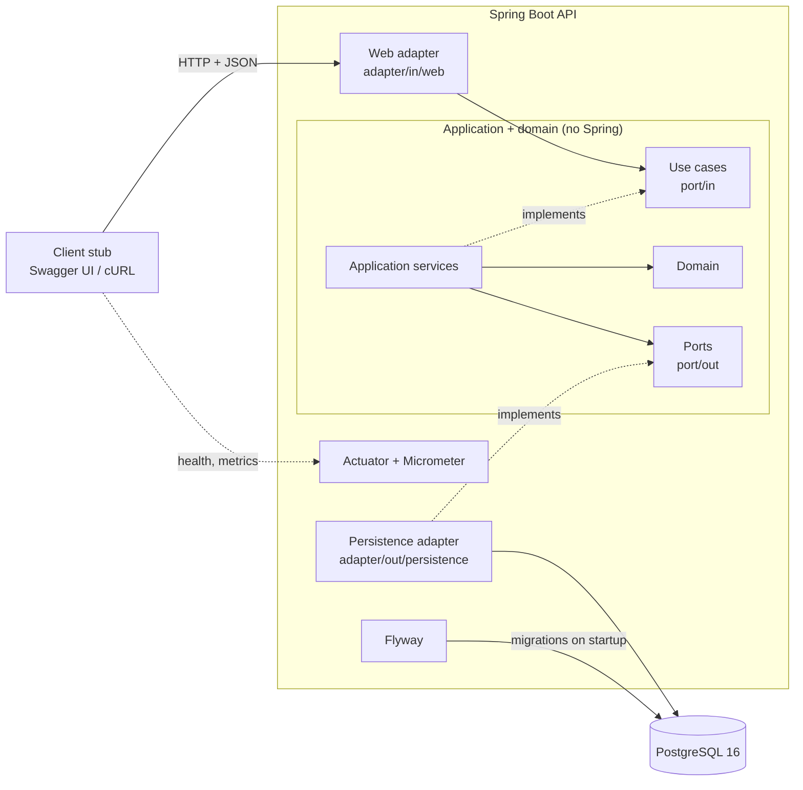
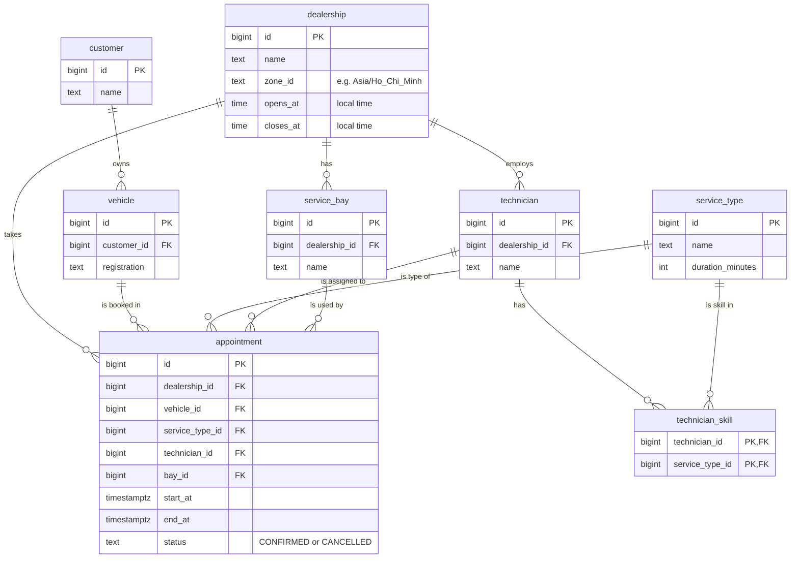
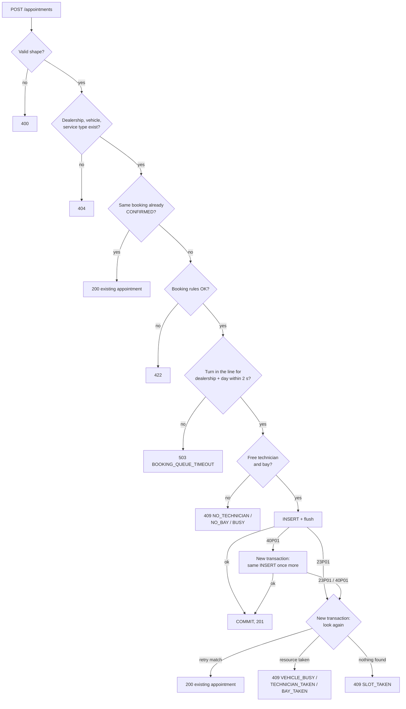
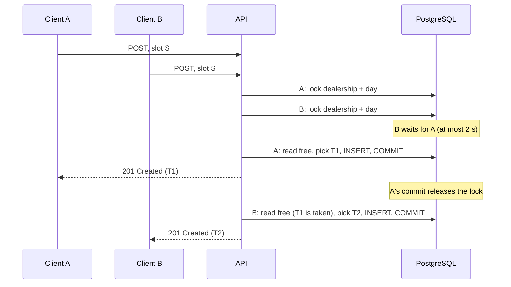

# System Design: Unified Service Scheduler

Keyloop challenge, Scenario A. Backend only: a REST API on PostgreSQL. Swagger UI and cURL stand in for the client.

## 1. Overview

The service books a service appointment for a vehicle at a dealership.
It picks a qualified technician and a free bay, and checks availability in the same transaction as the insert.
Bookings for one dealership and local day wait in line, so parallel requests share out every free technician and bay.
The database constraints stay as the last guard: if two requests still want the same technician, bay or vehicle, the first commit wins and the other gets 409.

## 2. Rules and assumptions

The brief leaves many rules open. Each row below is an assumption I made; the code and the tests follow it.

### Booking checks

| Rule | If broken |
|---|---|
| Request has the right shape: required fields, formats, time with offset | 400 `INVALID_REQUEST` |
| Dealership, vehicle and service type exist | 404 `DEALERSHIP_NOT_FOUND`, `VEHICLE_NOT_FOUND`, `SERVICE_TYPE_NOT_FOUND` |
| Start time is a whole minute (no seconds) | 422 `START_NOT_WHOLE_MINUTE` |
| Start time is after now | 422 `START_IN_PAST` |
| Start date is at most 90 days ahead (dealership calendar, day 90 allowed) | 422 `START_TOO_FAR_AHEAD` |
| The whole service fits inside opening hours | 422 `OUTSIDE_OPENING_HOURS` |
| At least one technician at the dealership has the skill | 422 `SERVICE_NOT_OFFERED` |
| A qualified technician is free | 409 `NO_TECHNICIAN` |
| A bay is free | 409 `NO_BAY` |
| Both of the two rows above | 409 `BUSY` if both fail |
| The vehicle has no overlapping booking | 409 `VEHICLE_BUSY` |
| The wait for other bookings of the same dealership and day is at most 2 s | 503 `BOOKING_QUEUE_TIMEOUT`, `Retry-After: 1` |

### How the system picks

| Picks | Rule | Tie |
|---|---|---|
| Technician | Has the service type in `technician_skill`, is free, has the fewest `CONFIRMED` appointments that day (dealership calendar) | Lowest id |
| Bay | Any free bay. All bays are equal. | Lowest id |

### Other rules

| Topic | Decision |
|---|---|
| Real-time | Availability is checked at booking time, in the same transaction as the insert. |
| Duration | From `service_type`. No buffer: an appointment can start when the previous one ends. |
| Opening hours | One open time and one close time per dealership, every day. No closed days, no hours past midnight. Technicians work all opening hours. |
| Hours check | Local date + `opens_at` / `closes_at` in the dealership zone, turned into UTC instants. Check `start >= open` and `end <= close`. Correct on clock-change days. |
| Clock-change hour | An `opens_at` or `closes_at` inside a skipped hour moves forward by the gap; one inside a repeated hour uses the earlier offset (java.time rules). Normal opening hours never fall there, so there is no special code. |
| Rule order | Several 422 rules fail: the first row of the booking checks table wins. For 409, `VEHICLE_BUSY` comes first, then `BUSY` / `NO_TECHNICIAN` / `NO_BAY`. |
| Concurrency | Bookings of one dealership and local day run one at a time: the first statement of the booking transaction takes a transaction-level advisory lock (`lock_booking_day`, migration V2) for that dealership and day, and waits at most 2 s for it. Then the exclusion constraints on technician, bay and vehicle (`CONFIRMED` only): first commit wins. Isolation: READ COMMITTED, which the line depends on: each read sees what the previous booking committed. |
| Lost race | Rare: only requests in different lines, such as one vehicle at two dealerships, can still race. 409 with what was taken (section 6, "After a DB error"). The server does not pick another technician or bay; it only replays the same insert once after a deadlock. The client sends again and gets another technician or bay. Why: section 8(c). |
| Retry | Same dealership + vehicle + start + service type, already `CONFIRMED`: 200 with that appointment, no `Location`. Checked after the ids exist (404 first) and before the booking rules, so a retry still gets 200 when the start has passed. A `CANCELLED` match is not a retry. |
| Time | Stored in UTC (`Instant`, `timestamptz`). Each dealership has a `ZoneId`. Requests: ISO-8601 with offset. Responses: UTC (`Z`). |
| Data | 8 tables. All except `appointment` are reference data; demo rows are loaded by Flyway only with the `demo` profile (Docker Compose, `bootTestRun`). Status is `CONFIRMED` or `CANCELLED`. No cancel endpoint in v1. |
| Security | No authentication (known gap). All input validated. No secrets in the repo. Local Docker Compose: PostgreSQL uses trust auth on the private Compose network and publishes no port, so there is no password. Other environments: DB password from an environment variable. Two database users: Flyway migrates as `scheduler_migrator` (owns the database), the API runs as `scheduler_app` (data access only, no schema changes, no access to `flyway_schema_history`). Every API connection has `lock_timeout` 5 s and `statement_timeout` 30 s; a timeout gives 500 (known gap). Only the wait in the booking line has its own 2 s limit and gives 503. |
| Errors | ProblemDetail (RFC 9457) for every error, including 400. The reason code is in a `reason` property. Unknown appointment id: 404 `APPOINTMENT_NOT_FOUND`. Unknown JSON fields are ignored. |

## 3. Architecture

Hexagonal (ports and adapters). Adapters depend on the application. The application depends only on the domain and on port interfaces.



## 4. Components

| Component | Role |
|---|---|
| Client stub | Swagger UI or cURL. Stands in for a front end. |
| Web adapter | Controller, request and response records, ProblemDetail mapping, request id. Checks request shape. |
| Use cases (`port/in`) | `BookAppointmentUseCase`, `GetAppointmentUseCase`. What the web adapter may call. |
| Application services | Run the flow in section 6. Each step runs in its own transaction through `TransactionPort`. No Spring annotations. |
| Domain | Booking rules and technician choice. No Spring or database code. |
| Ports (`port/out`) | `ReferenceDataPort`, `AppointmentPort`, `AvailabilityPort`, `TransactionPort`, `DealershipDayLockPort`. What the application needs from outside. |
| Persistence adapter | Spring Data JPA, native SQL for free technicians and bays, `saveAndFlush`, `TransactionTemplate`. Turns `23P01` / `40P01` into an application exception. |
| Config | Wires services to ports with `@Bean`. Provides the `Clock`. |
| PostgreSQL 16 | Data. Exclusion constraints are the last guard against double booking. |
| Flyway | Extension, tables, constraints, seed data. |
| Actuator + Micrometer | Health and metrics. |

## 5. Data model

All ids are `bigint`.



```sql
CREATE EXTENSION IF NOT EXISTS btree_gist;

ALTER TABLE dealership   ADD CONSTRAINT dealership_hours_valid CHECK (closes_at > opens_at);
ALTER TABLE service_type ADD CONSTRAINT service_type_duration_valid CHECK (duration_minutes BETWEEN 1 AND 480);
ALTER TABLE vehicle      ADD CONSTRAINT vehicle_registration_unique UNIQUE (registration);
ALTER TABLE appointment  ADD CONSTRAINT appointment_time_valid CHECK (end_at > start_at);
ALTER TABLE appointment  ADD CONSTRAINT appointment_status_valid CHECK (status IN ('CONFIRMED', 'CANCELLED'));

ALTER TABLE appointment
    ADD CONSTRAINT appointment_technician_no_overlap
    EXCLUDE USING gist (technician_id WITH =, tstzrange(start_at, end_at) WITH &&)
    WHERE (status = 'CONFIRMED');
-- Same for bay_id (appointment_bay_no_overlap) and vehicle_id (appointment_vehicle_no_overlap).

-- The technician and the bay belong to the appointment's dealership.
ALTER TABLE appointment
    ADD CONSTRAINT appointment_technician_dealership_fkey
    FOREIGN KEY (technician_id, dealership_id) REFERENCES technician (id, dealership_id);
-- Same for bay_id (appointment_bay_dealership_fkey).
```

The database does not check that the technician has the skill. The technician picker does.

Full schema: `src/main/resources/db/migration/V1__schema.sql`. `V2__booking_day_lock.sql` adds the `lock_booking_day` function (section 8(c)).

- `tstzrange` is `[start, end)` by default, so back-to-back bookings do not overlap.
- `end_at` is stored because a constraint cannot read `service_type` from another table.
- `btree_gist` lets `=` on `bigint` join `&&` in one GiST index. It is a trusted extension, so no superuser is needed.

## 6. Data flow

### API

| Endpoint | Success |
|---|---|
| `POST /appointments` | 201 + `Location` header, or 200 for a retry (no `Location`) |
| `GET /appointments/{id}` | 200 |

The OpenAPI 3.1 spec is at `/v3/api-docs`, and Swagger UI at `/swagger-ui.html`. The spec lists every status code of each path, and for each error status the reasons it can carry. Both have no authentication, so the `prod` profile turns them off (with the Swagger UI webjar).

<table>
<tr><th>Request</th><th>Response (201, 200, GET)</th></tr>
<tr><td>

```json
{
  "dealershipId": 1,
  "vehicleId": 42,
  "serviceTypeId": 3,
  "startTime": "2026-11-03T09:00:00+07:00"
}
```

</td><td>

```json
{
  "id": 101,
  "status": "CONFIRMED",
  "dealershipId": 1,
  "vehicleId": 42,
  "serviceTypeId": 3,
  "technicianId": 7,
  "bayId": 2,
  "startTime": "2026-11-03T02:00:00Z",
  "endTime": "2026-11-03T03:30:00Z"
}
```

</td></tr>
</table>

Error (409 example):

```json
{
  "type": "about:blank",
  "title": "Conflict",
  "status": 409,
  "detail": "The technician was booked by another request. Send the request again.",
  "reason": "TECHNICIAN_TAKEN"
}
```

### POST /appointments: steps



### POST /appointments: another request takes the slot first



### After a DB error

The line makes these errors rare: requests of the same dealership and day no longer race. They remain possible between lines, for example one vehicle booked at two dealerships at once.

On `23P01` (exclusion_violation) or `40P01` (deadlock_detected), the transaction is rolled back.

1. On `40P01` only: a new transaction runs the same insert once more, with the same technician and bay. No new choice is made. This time the insert waits for the winner, so it ends in `23P01`, or in 201 if the winner rolled back.
2. A new transaction looks again, in this order:

| # | Found | Response |
|---|---|---|
| 1 | Retry match: same dealership, vehicle, start, service type, `CONFIRMED` | 200 with that appointment |
| 2 | The vehicle has an overlapping `CONFIRMED` appointment | 409 `VEHICLE_BUSY` |
| 3 | The chosen technician is taken | 409 `TECHNICIAN_TAKEN` |
| 4 | The chosen bay is taken | 409 `BAY_TAKEN` |
| 5 | Nothing (the winner has not committed yet) | 409 `SLOT_TAKEN` |

Why look again instead of reading the error:

- `40P01` does not say which resource was taken, and it is common. In a test on PostgreSQL 16 with truly simultaneous inserts, about 3 in 4 losers got `40P01`, not `23P01`.
- After `40P01` the winner may not have committed yet. Running the same insert again waits for it, so the look-again step sees the result.
- A retry can arrive before the first request commits. Looking again turns it into 200.
- Without this step, either error would reach the client as 500.

## 7. Technology choices

| Technology | Why |
|---|---|
| Java 21 | LTS. Records for DTOs and domain objects. |
| Spring Boot 4.1 | Validation, transactions and ProblemDetail built in. Spring Boot 3 lost free (OSS) support on 2026-06-30. |
| Spring Data JPA | Simple CRUD. Native SQL where PostgreSQL features are needed. |
| Gradle | Build and tests, local and CI. |
| PostgreSQL 16 | Exclusion constraints, range types, `btree_gist`. |
| Flyway | Same SQL migrations everywhere. |
| JUnit 5 | Standard test framework. |
| Testcontainers | Real PostgreSQL in tests. See 8(b). |
| springdoc-openapi | OpenAPI spec and Swagger UI from code. |
| Actuator + Micrometer | Health and metrics with little code. |
| Docker Compose | API + PostgreSQL with one command. |
| GitHub Actions | Build and test on every push. |

## 8. Decisions

### (a) How to stop double booking

| Option | Weak point |
|---|---|
| Check in code (`SELECT`, then `INSERT`) | Two transactions both see "free" and both insert. Safe only with SERIALIZABLE + retries. |
| Pessimistic lock (`SELECT ... FOR UPDATE`) | The new row does not exist yet. Must lock technician, bay and vehicle rows in a fixed order. A new code path can forget. |
| **Exclusion constraint** ✅ | PostgreSQL only. Must handle `23P01` and `40P01` (section 6). |

Chosen because the database enforces the rule for every write path.
The code still checks first, to pick a technician and bay and to return `NO_TECHNICIAN` / `NO_BAY`.

### (b) Test database

| Option | Weak point |
|---|---|
| H2 | No `EXCLUDE`, no range types, no `btree_gist`. Migrations fail. The core rule cannot be tested. |
| **Testcontainers** ✅ | Needs Docker. Slower start. GitHub Actions Linux runners have Docker. |

Proof test: N parallel requests for one slot. Expect as many 201s as free technician-and-bay pairs, the rest 409 with the real reason.

### (c) Parallel requests: a queue per dealership and day

| Option | Weak point |
|---|---|
| 409 with the reason, client sends again (v1) | Parallel requests all pick the same technician first (fewest bookings, then lowest id), so losers get 409 while another technician is free, and the third of three clients sends three times. Losers often deadlock, and ten racing requests took up to about 20 s. |
| The server picks another free technician or bay and inserts again | Under load one request can lose several times, so it needs a retry limit. Each new try repeats the reads and the race, and adds load when the slot is full anyway. |
| **Advisory lock per dealership and local day** ✅ | Bookings of one dealership and day cannot run in parallel. A waiting request holds a database connection (section 11). |
| Distributed lock in Redis | A new service to run. The lock lives outside the transaction, so releasing it after the commit is up to the code, and an expired lease lets two holders in. |
| Message queue (Kafka, RabbitMQ) | A new service to run, and the API turns asynchronous (202, then poll or webhook), so every client changes. |

Chosen because it needs no new infrastructure and its lifetime is exactly the transaction's: PostgreSQL makes the commit visible before it releases the lock, so the next booking in line always reads the latest state.
Ten parallel requests for one slot now finish in about 20 to 45 ms in tests, and each gets a free technician and bay while there is one.
The wait is limited to 2 s by `SET lock_timeout` on the `lock_booking_day` function; PostgreSQL restores the connection's 5 s when the function returns.

## 9. Observability

| What | How |
|---|---|
| Request id | Every response carries `X-Request-Id`. A caller's value is kept if it matches `[A-Za-z0-9._-]{1,64}` (first header only); anything else is replaced by a new UUID and never logged. The id is set before the request runs, so error responses carry it too. A request Tomcat rejects before the filter chain (malformed request line or header) has no id. |
| Logs | JSON on the console, ECS format (`logging.structured.format.console=ecs`). Each line written during a request has `requestId`. No request body, headers or customer data. The `Exception` catch-all logs the full cause at ERROR, which can hold SQL text: keep logs access-restricted, with short retention. |
| Health | `/actuator/health`: 200 `UP` or 503 `DOWN`, with the `db` component. No details (no URL, no database name). |
| Latency | `http.server.requests`, tags `method=POST`, `uri=/appointments`, `status`, `outcome`. Read it at `/actuator/metrics/http.server.requests`. |
| Race replays | One INFO line per replay after a deadlock: `outcome=stored`, or `outcome=lost kind=…`. No ids, no SQL. |
| Tracing | Not built. There is one service and one database, so the request id already ties together every log line of a request. With more services: Micrometer Tracing with OpenTelemetry, and the trace id in the same log field. |

What to watch in production:

| Signal | What it tells |
|---|---|
| 5xx rate on `POST /appointments` | A bug, database trouble or a timeout (a timeout gives 500, section 2). |
| 409 rate by reason | `NO_TECHNICIAN` / `NO_BAY` high: the dealership is short of capacity. `TECHNICIAN_TAKEN` / `SLOT_TAKEN` high: many clients want the same slot. Needs the counter by reason (section 11). |
| p95 latency of `POST /appointments` | Lock waits or a slow database. |
| Replay lines with `outcome=lost` | How often races end in a deadlock. Expected near zero now that bookings queue. |
| 503 rate on `POST /appointments` | `BOOKING_QUEUE_TIMEOUT`: one dealership and day gets more bookings at once than the line clears in 2 s. |
| Health `DOWN` | The database cannot be reached. Page someone. |

`/actuator/health` and `/actuator/metrics` are on the API port with no authentication, like the API itself. Restrict them once authentication is added.

## 10. How I used GenAI in design

I used Claude in chat to question the brief and to critique the plan, and Claude Code to write the documents. The AI proposed; I decided.
Requirements and design were two checkpoints I approved before any code was written.

| Step | What the AI did | What I did |
|---|---|---|
| Find gaps in the brief | Listed rules the brief leaves open: opening hours, time zone, who picks the technician, past dates, buffer time. Gave two options with trade-offs for each. | Wrote my own list of open questions first, then compared. Chose one option per question (section 2). My question "what if the client loses the connection after it confirms?" led to the vehicle constraint and the safe retry rule. |
| Choose how to stop double booking | Compared a check in code, row locks and exclusion constraints (section 8(a)). | Chose the exclusion constraint, and had it tried on a real PostgreSQL 16 before any code: overlaps rejected, back-to-back bookings allowed, cancelled rows ignored, one winner out of two parallel inserts. |
| Test the race on a real database | Ran truly simultaneous inserts. | Saw that about 3 in 4 losers get `40P01` (deadlock), not `23P01`. Built the replay and look-again steps (section 6) around that. |
| Critique the plan | Checked each claim against sources. Found that Spring Boot 3.x lost free support on 2026-06-30, and that parallel requests all pick the same technician. | Moved to Spring Boot 4.1. Kept 409 for a lost race at first, then replaced it with a queue per dealership and day (section 8(c)). |
| Write the documents | Drafted the requirements, this design, the conventions and the backlog. | Reviewed and approved each one. Wrote the rules the AI must follow while coding (`docs/conventions.md`). |

## 11. Scalability, reliability and future work

### Scalability and reliability

| Concern | How the design handles it | Next step if needed |
|---|---|---|
| More API instances | The API keeps no state. The no-double-booking rule lives in PostgreSQL, so any number of instances behind a load balancer stay correct. No distributed lock, no sticky sessions. | — |
| Many requests for one slot | Bookings of one dealership and day queue on an advisory lock (section 8(c)). Ten parallel requests finish in about 20 to 45 ms in tests. A wait over 2 s gives 503. Known limit: a waiting request holds a pool connection (10 by default), so a burst of more than 10 at one dealership and day can leave other dealerships waiting up to 5 s for a connection and then getting 500. | Limit the waiting requests per dealership and day inside the API, before they take a connection, and answer 503 at once. |
| Client retries | A repeated booking (same dealership, vehicle, start, service type) returns 200 with the stored appointment, so a client can retry safely after a timeout. | An `Idempotency-Key` header. |
| Database down or slow | Health turns 503 `DOWN`. A request waits at most 5 s for a connection, then fails instead of hanging. | Client retry with backoff; a read replica for `GET`. |
| Data growth | Every booking belongs to one dealership (composite foreign keys), so the data can be split by dealership later. | Move past appointments to a history table; split data by dealership. |
| Changing the code | Hexagonal layers, checked by ArchUnit tests. Schema changes only through new Flyway migrations. The API's database user cannot change the schema. | — |

### Future work

| Item | Why not in v1 |
|---|---|
| Authentication and authorization | Out of scope for the challenge. Needed before real use: a customer may book only their own vehicles, on the retry path too. |
| Cancel and reschedule endpoints | The brief asks only to book. The schema already has `CANCELLED`, and the constraints ignore cancelled rows. |
| List free slots before booking | The brief asks to check availability at booking time. |
| Opening hours per weekday, holidays, technician shifts and days off | One opening window per day keeps the rules simple (section 2). |
| Buffer time between appointments | Not asked for. |
| Manage customers, vehicles and reference data | Seed data is enough for the demo. |
| Live push of availability (WebSocket or SSE) | Keeps a calendar screen fresh. It does not replace the check at booking time. |
| `Idempotency-Key` header | The retry rule covers the common case. |
| Rate limiting | Belongs at the API gateway. |
| Booking counter by result and reason; counter for `40P01` | Today only latency per status and the replay log lines exist (section 9). |
